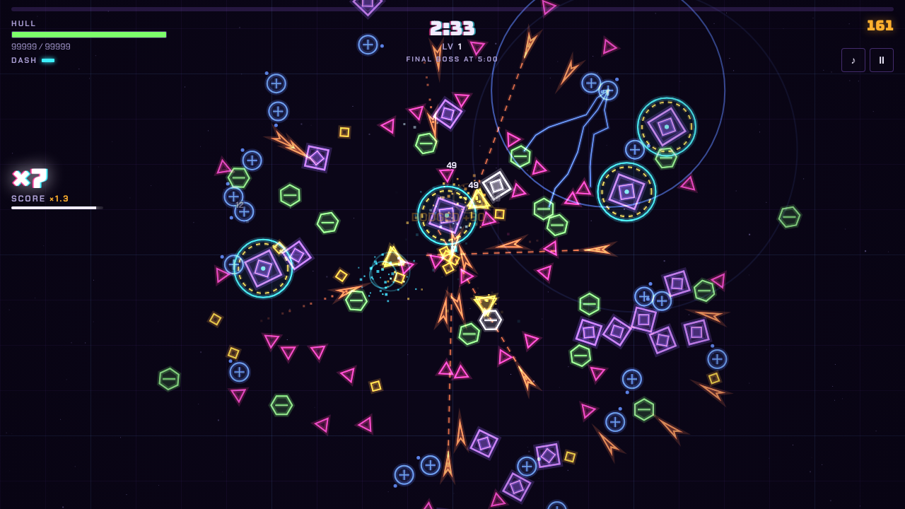
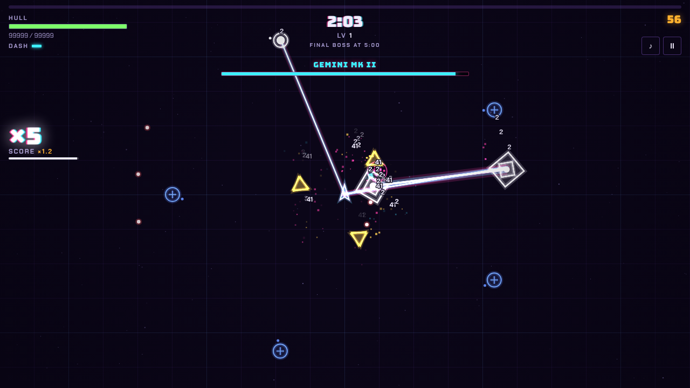
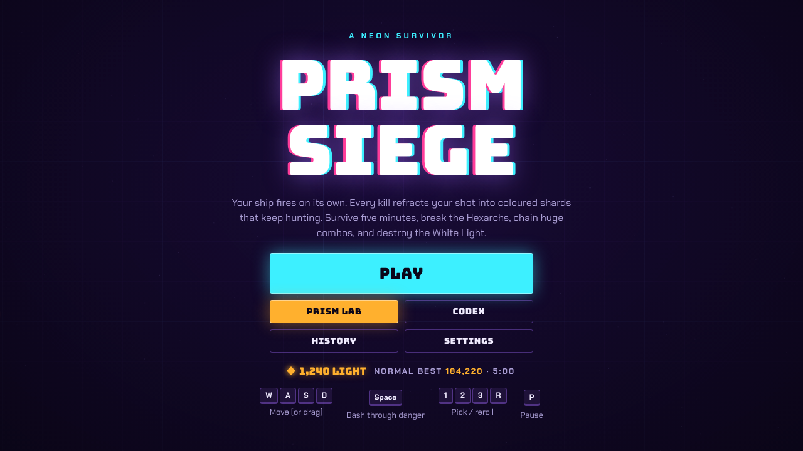

# Prism Siege

**A neon arena survivor where every kill refracts your shot into coloured shards that keep hunting.**

### ▶ [Play it in your browser](https://duncandosomething.github.io/Prism-Siege/)

Your ship fires on its own. You steer, dash through danger and decide what your ship turns into. Survive five minutes, break the mid-bosses, chain huge combos and destroy the White Light.

---

## About this project

Prism Siege is a **vibe-coding experiment**: I wanted to see how far I could take a game by building it together with [Claude](https://claude.ai), Anthropic's AI assistant. Claude wrote the code and made most of the design calls. I directed the project, playtested every version and turned what I found into feedback for the next round.

A lot of the game came straight out of those playtests:

- **Normal and Hard modes.** Picking up experience while the screen is full felt too punishing, so Normal now collects it for you, and pickup upgrades only appear in Hard.
- **Near-miss effect.** Barely dodging something should feel great, so it now triggers a short slow-motion, a chromatic split of the ship and a dash refund.
- **A combo meter that grows with you.** The combo counter was easy to miss, so it became a tiered meter that rewards you for keeping it alive.
- **Five-minute runs and steeper scaling.** Ten-minute runs got comfortable after minute four, so the run got shorter and enemies scale harder.
- **Boss indicators.** Bosses were hard to find in the open arena, so they now spawn closer and get a marker with their distance on the screen edge.
- **Bug reports.** For example, the boss marker jumped around the screen when you ran away from a boss. The boss was being teleported to a random spot, and now it follows you along the same line.

## Features

- **Refraction.** Killing blows split your shot into shards that keep flying, and upgrades let those shards split again.
- **4 weapons:** Prism Blaster, Scatter Cannon, Prism Beam and Seeker Pods.
- **15 upgrades and 5 secret evolutions** that unlock when two upgrades reach the right level.
- **12 relics** from boss chests, several of them built around near misses.
- **3 rotating mid-bosses** (Hexarch, Gemini and Singularity) and a three-phase final boss, the White Light.
- **8 enemy types and 4 elite traits** (Shielded, Swift, Volatile, Brood).
- **3 arenas:** The Void, Mirror Hall (your shots bounce off the walls) and Collapse (a shrinking safe zone).
- **Meta-progression.** Spend Light in the Prism Lab on permanent upgrades, ships and weapons.
- **Intensity 0–8.** Every win unlocks the next level, each with an extra modifier and more Light.
- **Procedural synthwave soundtrack** that gets heavier during boss fights.
- **Codex, run history and settings**, plus tips the first time something new happens.

## Controls

| Action | Keyboard | Touch |
| --- | --- | --- |
| Move | WASD or arrow keys | Drag anywhere |
| Dash (you can't be hit while dashing) | Space | DASH button |
| Pick an upgrade | 1, 2, 3 or click | Tap a card |
| Reroll upgrades | R | REROLL button |
| Pause | P or Esc | Pause button |
| Mute | M | Sound button |

## How it's built

- **One HTML file, no build step and no dependencies.** Plain JavaScript on an HTML5 canvas.
- **No image or audio assets.** Every ship, enemy, boss and effect is drawn in code, and all sound effects and music are synthesised live with the Web Audio API.
- **Saves to `localStorage`.** Your Light, unlocks, codex and run history stay in your browser.
- Fonts: [Bungee](https://fonts.google.com/specimen/Bungee) and [Chakra Petch](https://fonts.google.com/specimen/Chakra+Petch) from Google Fonts.

## Run it locally

Download `index.html` and open it in a browser. That's all.

